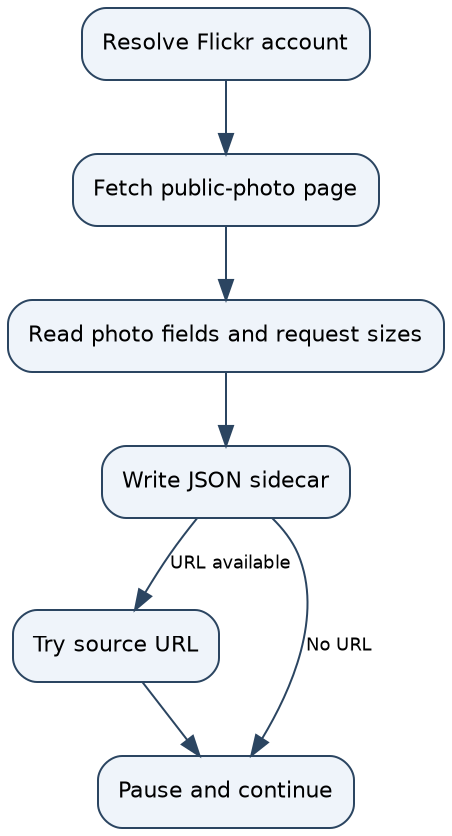

# Archiving method

The script attempts a username lookup first. On failure it can try a
username from the photostream URL, try the URL path as an account identifier,
or match an identifier in page HTML and verify that identifier through the
API. Once the account resolves, `flickr.people.getPublicPhotos` provides the
listing and requested metadata. The script requests 100 records per page and
uses the API's returned page count to continue [@flickr-public-photos].

For each listing entry, the script builds a sidecar and queries
`flickr.photos.getSizes` for download URLs [@flickr-photo-sizes]. The
default priority order is `X-Large`, `Large 2048`, `Large 1600`, `Large`,
then `Original`. If no configured label matches, the script selects the final
entry in Flickr's returned size list. That fallback depends on the list
order. The priority list can select a derivative even when an original
URL exists.

{width=42%}

The filename stem combines the photo ID and up to fifty sanitized title
characters. The script attempts to write the sidecar before streaming the
image. A download failure reported by the downloader triggers another
sidecar write with an error message. A one-second pause follows each
processed listing entry.
